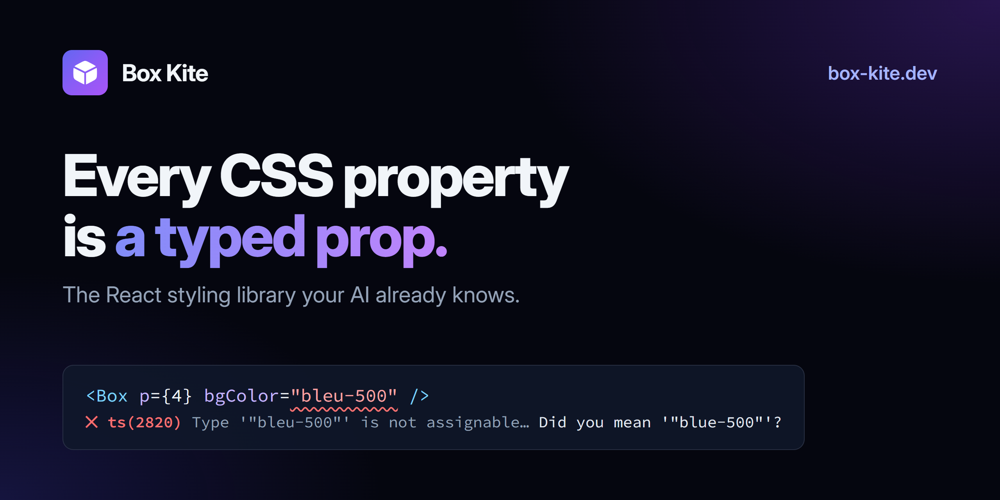

<div align="center">

<a href="https://www.box-kite.dev">
  
</a>

<h3>The AI-first, fully typed styling library for React</h3>

<p>
  <a href="https://www.npmjs.com/package/@box-kite/react"></a>
  <a href="https://github.com/box-kite/box-kite/actions/workflows/test.yml"></a>
  
  <a href="#-packages"></a>
  <a href="#-built-for-ai-agents"></a>
  <a href="https://www.npmjs.com/package/@box-kite/mcp"></a>
  <a href="LICENSE"></a>
</p>

<p>
  <a href="https://www.box-kite.dev"><b>Docs</b></a> ·
  <a href="https://www.box-kite.dev/start-with-ai/"><b>Start with AI</b></a> ·
  <a href="https://www.box-kite.dev/playground/">Playground</a> ·
  <a href="https://www.box-kite.dev/showcase/">Showcase</a> ·
  <a href="https://www.box-kite.dev/blog/">Blog</a> ·
  <a href="https://github.com/box-kite/box-kite/releases">Releases</a>
</p>

</div>

---

**Box Kite** styles React in TypeScript. Every CSS property is a prop on `Box`, every value it takes is a type, and the CSS is
written for you at runtime — one shared class per value, no stylesheet to import, no class names to invent, no build plugin.

It is built to be **written by an AI**: the rules and a reference measured from the engine ship inside the package, an MCP
server checks a prop bag against the real engine, and the compiler refuses a value the library would not render.

<!-- prettier-ignore -->
```tsx
import Button from '@box-kite/react/components/button';
import Flex from '@box-kite/react/components/flex';
import { H2, P } from '@box-kite/react/components/semantics';

export function PlanCard() {
  return (
    <Flex d="column" gap={3} p={6} md={{ p: 8 }} borderRadius={3} shadow="md"
          bgColor="white" theme={{ dark: { bgColor: 'slate-900' } }}>
      <H2 fontSize={20} fontWeight={600}>Pro plan</H2>
      <P color="slate-600">Every value on this card is checked by the compiler.</P>
      <Button hover={{ bgColor: 'indigo-600' }}>Upgrade</Button>
    </Flex>
  );
}
```

Each prop becomes one shared class: `p={6}` is `padding: 1.5rem`, `md` wraps it in a media query, `theme` scopes it to the dark
subtree, and the same value anywhere else in the app reuses the same rule.

## ⚡ Quick start

Start a new Vite + React app with a design, a sample page and the agent setup already in it:

```bash
npm create @box-kite@latest
```

Or add it to the app you have:

```bash
npm install @box-kite/react
```

React 18 or newer, and **no third-party dependencies**: the install is Box Kite and its own engine, nothing else. TypeScript is
optional, but it is where the library shines.

## ✨ Why Box Kite

<table>
  <tr>
    <td width="50%" valign="top">
      <h4>🤖 AI-first</h4>
      <p>The package carries its own <code>AGENTS.md</code>, a <code>docs/</code> folder and a skill, all generated from the prop
      registry so they can never be a version behind. An MCP server answers mid-task.</p>
    </td>
    <td width="50%" valign="top">
      <h4>🔒 Typed down to the value</h4>
      <p>Every prop accepts a closed set: palette tokens, scale steps, keywords. A typo is a compile error with a
      <i>“Did you mean”</i>, not a silently missing style.</p>
    </td>
  </tr>
  <tr>
    <td valign="top">
      <h4>🧩 Zero config, zero dependencies</h4>
      <p>No CSS files, no PostCSS, no bundler plugin, no provider — and no third-party packages in your lockfile. Styles are
      generated on demand and deduplicated by content.</p>
    </td>
    <td valign="top">
      <h4>🖥️ Server Components</h4>
      <p>Renders in a React Server Component with no <code>'use client'</code>: each rule travels with the markup as a
      <code>&lt;style&gt;</code> React 19 hoists and dedupes.</p>
    </td>
  </tr>
  <tr>
    <td valign="top">
      <h4>♿ Accessible components</h4>
      <p>Dialog, Menu, Tabs, Combobox, DatePicker, DataGrid and more — each with the ARIA and keyboard of its APG pattern, swept
      by axe in CI.</p>
    </td>
    <td valign="top">
      <h4>🎨 Modern CSS, as props</h4>
      <p>OKLCH palette, themes, container queries, <code>@starting-style</code>, anchor positioning, view transitions, scroll
      timelines — and the top layer instead of <code>z-index</code>.</p>
    </td>
  </tr>
</table>

## 🤖 Built for AI agents

A model's memory of a CSS-in-JS API is usually a memory of a _different_ API — the prop names here collide with Tailwind's
and Chakra's while the numbers mean something else. So Box Kite does not rely on what a model remembers:

| What                                               | How you get it                                                                                        |
| -------------------------------------------------- | ----------------------------------------------------------------------------------------------------- |
| **`AGENTS.md` + `docs/`** inside the npm package   | Automatic — `node_modules/@box-kite/react/AGENTS.md`, with every prop and the CSS it writes           |
| **Project wiring** (`AGENTS.md`, `CLAUDE.md`, MCP) | `npm create @box-kite@latest -- --agents-only` — merges into an existing repo, and updates on a rerun |
| **Skill** for Claude Code, Cursor, Codex, Copilot… | `npx skills add box-kite/box-kite`                                                                    |
| **MCP server** — no key, no network                | `claude mcp add box-kite -- npx -y @box-kite/mcp` (or the stdio config your editor takes)             |
| **llms.txt** and markdown docs                     | [box-kite.dev/llms.txt](https://www.box-kite.dev/llms.txt) — append `.md` to any docs URL             |

**`check_styles` runs your props through the real engine.** A value the library does not accept writes no rule and no class
name — by design, so a typo never emits a broken declaration. The MCP tool makes that visible before anything renders:

```text
✅ p         → .p-4{padding:1rem}
❌ bgColor   does not accept "blue-550" — no rule and no class name were written.
✅ fontSize  → .fontSize-14{font-size:0.875rem}
⚠️ href      an HTML attribute, not a style prop. Written at the top level it typechecks
             and is then dropped — it goes in props={{ "href": … }}.
```

**The dev console is written as a prompt.** Each warning says what rendered and the line to write instead, so an agent reading
a test run fixes itself:

```text
[box-kite] bgColor="bleu-500" wrote no CSS: bgColor does not take that value, so the prop
           was dropped along with its class. Did you mean "blue-500"?
[box-kite] fontSize={4} is 4px text: fontSize's divider is 16, not the spacing scale's 4,
           so the number is the pixel size. For 16px write fontSize={16}.
```

**And a UI a model writes at runtime is a first-class citizen.** `catalog()` turns every component and every value its props
take into JSON Schema — the shape structured output, json-render and A2UI want — and `<SpecRenderer>` renders what comes back,
checking each node against an allow-list you control. `toolPart()` and `a2uiToSpec()` read AI SDK, assistant-ui, CopilotKit,
AG-UI and A2UI, and `<ToolCallCard>`, `<ApprovalCard>`, `<Reasoning>` and `<StreamingText>` draw an agent's turn.
→ [Generative UI](https://www.box-kite.dev/generative-ui/) · [Agent components](https://www.box-kite.dev/agent/) ·
[Interop](https://www.box-kite.dev/interop/)

## 🔒 Typed down to the value

Props are not `string`. Colours are palette tokens (with an optional `/opacity`), spacing is a scale, keywords are unions — so
the editor autocompletes them and the compiler catches the rest:

<!-- prettier-ignore -->
```tsx
<Box bgColor="bleu-500" />
//   ~~~~~~~ ts(2820): Type '"bleu-500"' is not assignable… Did you mean '"blue-500"'?

<Box display="flexx" />
//   ~~~~~~~ ts(2820): … Did you mean '"flex"'?

<Box opacity={50} />
//   ~~~~~~~ ts(2322): Type '50' is not assignable to type '0 | 1 | 0.1 | 0.2 | …'

<Button variant="primaryy">Save</Button>
//      ~~~~~~~ ts(2322): a component's variants are typed too

<Box css={{ mixBlendMod: 'multiply' }} />
//          ~~~~~~~~~~~ ts(2561): … Did you mean to write 'mixBlendMode'?
```

- **Hover a prop, see its CSS.** Every prop's JSDoc carries an example such as `p={4} → padding: 1rem` — generated by running
  the engine, so the editor can never teach a scale the library stopped using.
- **Your own tokens join the types.** `Box.extend()` adds variables, props and values; one `declare module` makes them
  autocomplete like the built-ins. `Box.components()` variants are typed the same way.
- **The escape hatch is typed too.** `css={{ … }}` is checked against `csstype` and still compiles to a shared class — never a
  `style` attribute.

## 📐 The scales

The one thing worth learning by heart — the divider is per prop:

| Prop                                     | Scale               | Example                                  |
| ---------------------------------------- | ------------------- | ---------------------------------------- |
| `p`, `m`, `gap`, `width`, `borderRadius` | ÷4 (quarter rem)    | `p={4}` → `1rem` (16px)                  |
| `fontSize`                               | ÷16                 | `fontSize={14}` → `0.875rem` (14px)      |
| `b` (border width), `lineHeight`         | px                  | `b={1}` → `1px`                          |
| `animationDuration`, `transitionDelay`…  | ms                  | `transitionDuration={150}` → `150ms`     |
| colours                                  | tokens + `/opacity` | `bgColor="blue-500/40"` → `color-mix(…)` |

Three conventions follow from "every visual value is a prop": the element comes from the component (`<Flex>`, `<Button>`,
`<H1>`, `<Path>`), HTML attributes go in `props` (`<Link props={{ href: '/about' }}>`), and there is no `style={{ }}`.

## 🧱 Components

Every component is a `Box` underneath — same props, same theming, same `variant`s — and each is its own entry point, so a
`Textbox` never pulls the `DataGrid` into your bundle.

| Area                  | Components                                                                                                                                                                                                                                                                                                                                                  |
| --------------------- | ----------------------------------------------------------------------------------------------------------------------------------------------------------------------------------------------------------------------------------------------------------------------------------------------------------------------------------------------------------- |
| **Layout & content**  | [`Flex`](https://www.box-kite.dev/flex/), [`Grid`](https://www.box-kite.dev/grid/), `H1`–`H6`, `P`, `Link`, `Nav`…, [`List`](https://www.box-kite.dev/list/), [`Svg` + every SVG element](https://www.box-kite.dev/svg/), [`Icon`](https://www.box-kite.dev/icon/), `Skeleton`                                                                              |
| **Forms**             | [`Button`](https://www.box-kite.dev/button/), [`Textbox`](https://www.box-kite.dev/textbox/), [`Checkbox`](https://www.box-kite.dev/checkbox/), [`Switch`](https://www.box-kite.dev/switch/), [`RadioGroup`](https://www.box-kite.dev/radiobutton/), [`Combobox`](https://www.box-kite.dev/combobox/), [`Slider`](https://www.box-kite.dev/slider/), `Form` |
| **Dates**             | [`DateField`](https://www.box-kite.dev/date-field/), [`Calendar`](https://www.box-kite.dev/calendar/), [`DatePicker`](https://www.box-kite.dev/date-picker/), `TimeZoneSelect` — over a zone-safe [date module](https://www.box-kite.dev/dates/)                                                                                                            |
| **Overlays**          | [`Dialog`](https://www.box-kite.dev/dialog/), [`Popover`](https://www.box-kite.dev/popover/), [`Menu`](https://www.box-kite.dev/menu/), [`Tooltip`](https://www.box-kite.dev/tooltip/), [`Toaster`](https://www.box-kite.dev/toaster/) — in the top layer, no portal, no `z-index`                                                                          |
| **Disclosure**        | [`Tabs`](https://www.box-kite.dev/tabs/), [`Accordion`](https://www.box-kite.dev/accordion/), [`Progress`](https://www.box-kite.dev/progress/)                                                                                                                                                                                                              |
| **Data & dashboards** | [`DataGrid`](https://www.box-kite.dev/datagrid/) (sort, filter, group, edit, paste, virtualized), [`DashboardGrid`](https://www.box-kite.dev/dashboard/), [`Sparkline`, `Gauge`, `ChartContainer`](https://www.box-kite.dev/charts/)                                                                                                                        |
| **AI**                | [`ToolCallCard`, `ApprovalCard`, `Reasoning`, `StreamingText`](https://www.box-kite.dev/agent/), `markdownComponents`, [`SpecRenderer`](https://www.box-kite.dev/generative-ui/)                                                                                                                                                                            |

The behaviour behind them ships on its own as `@box-kite/react/a11y` — focus return, roving focus, dismissal and controllable
state — for the widgets you build yourself.

## 🖥️ Server Components

```tsx
// app/page.tsx — a Server Component. No 'use client', no provider, no CSS import.
import Flex from '@box-kite/react/components/flex';
import { H1 } from '@box-kite/react/components/semantics';

export default function Page() {
  return (
    <Flex d="column" gap={2} p={6}>
      <H1 fontSize={24}>Rendered on the server</H1>
    </Flex>
  );
}
```

The `react-server` export condition resolves to a hook-free build of Box; each rule comes back as a `<style href precedence>`
element that React 19 hoists into `<head>` and dedupes, so it is stream-safe and the cascade is held by `@layer`, not by element
order. → [How it works](https://www.box-kite.dev/server-components/) ·
[measured against CSS modules](https://www.box-kite.dev/blog/styling-server-components/) ·
[a whole Next.js app](examples/next-app)

## 📦 Packages

| Package                                                              | What it is                                                                                                                       |
| -------------------------------------------------------------------- | -------------------------------------------------------------------------------------------------------------------------------- |
| [`@box-kite/react`](https://www.npmjs.com/package/@box-kite/react)   | `Box`, every component and hook; depends on `@box-kite/core` and nothing else                                                    |
| [`@box-kite/core`](https://www.npmjs.com/package/@box-kite/core)     | the styling engine with no framework and no dependencies — `createStyleEngine().classNames(props)` ([example](examples/vanilla)) |
| [`@box-kite/mcp`](https://www.npmjs.com/package/@box-kite/mcp)       | the MCP server: docs search, props, components, rules and `check_styles`                                                         |
| [`@box-kite/create`](https://www.npmjs.com/package/@box-kite/create) | `npm create @box-kite` — a Vite + React app with a design and the agent setup                                                    |

## 📚 Learn more

- **[Documentation](https://www.box-kite.dev)** — every prop and component, with live demos
- **[Start with AI](https://www.box-kite.dev/start-with-ai/)** — build an app in three prompts with Claude Code, Cursor, Codex or Copilot
- **[Built for AI](https://www.box-kite.dev/ai-context/)** — what ships for agents, and why
- **[Theming](https://www.box-kite.dev/theme-setup/)**, **[Extending](https://www.box-kite.dev/box-functions/)**,
  **[Escape hatch](https://www.box-kite.dev/escape-hatch/)**
- **[`BOX_KITE_AI_CONTEXT.md`](src/BOX_KITE_AI_CONTEXT.md)** — the whole surface on one page

## 🤝 Contributing

Issues and pull requests are welcome — start with [CONTRIBUTING.md](CONTRIBUTING.md), which covers the architecture and the
framework-free core boundary. Questions go to [SUPPORT.md](SUPPORT.md), vulnerabilities to [SECURITY.md](SECURITY.md).

If Box Kite saves you time, a ⭐ on [GitHub](https://github.com/box-kite/box-kite) helps other people find it.

## License

[MIT](LICENSE) © Maxim Procopenco
